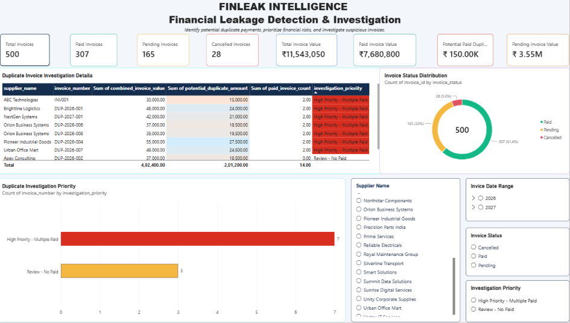
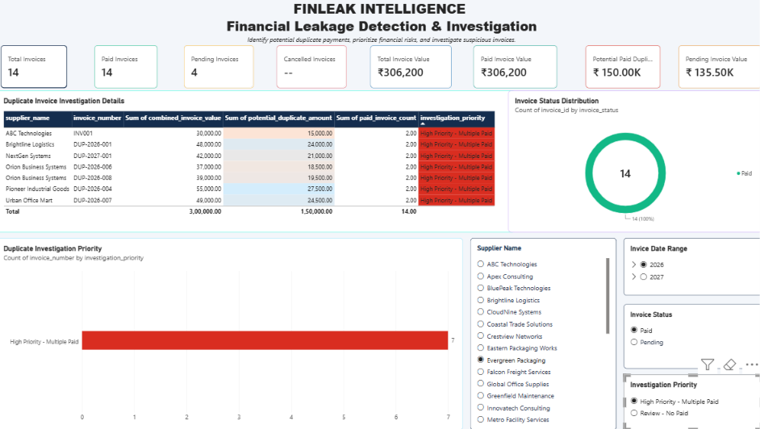
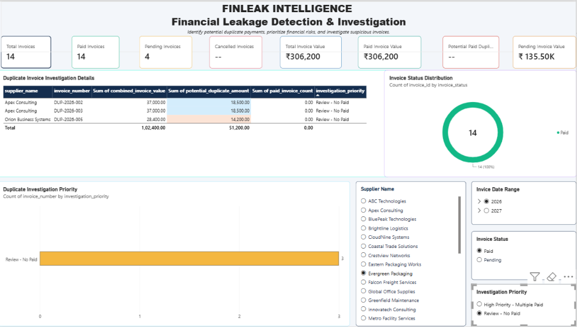

# FinLeak-Intelligence
Financial Leakage Detection &amp; Investigation System using MySQL, SQL and Power BI.
# FinLeak Intelligence — Financial Leakage Detection & Investigation System

## Project Overview
FinLeak Intelligence is a financial analytics project built using MySQL and Power BI to identify potential duplicate invoices, investigate possible duplicate payments, and prioritize cases for review.

The project transforms invoice data into actionable insights through SQL-based investigation and an interactive Power BI dashboard.

## Business Problem
Organizations may accidentally process the same supplier invoice more than once. This can create financial leakage and increase the time needed for manual invoice reviews.

This project helps identify duplicate invoice records and prioritize cases that may require further investigation.

## Tools and Technologies
- MySQL
- SQL
- Microsoft Power BI
- DAX
- Data visualization and financial analysis

## Dataset
- 500 invoice records
- 30 suppliers
- Invoice details include supplier ID, invoice number, invoice date, invoice amount, and invoice status.

## Key Features
- Duplicate invoice detection using supplier ID and invoice number
- Supplier and invoice status analysis
- Investigation priority classification
- KPI cards for invoice counts and financial values
- Interactive filters for supplier, invoice status, invoice date, and investigation priority
- Conditional formatting to highlight high-priority cases

## Key Findings
- Total invoices: 500
- Total invoice value: ₹11,543,050
- Paid invoice value: ₹7,680,800
- Pending invoice value: ₹3,549,550
- Cancelled invoice value: ₹312,700
- Duplicate invoice groups identified: 10
- High-priority groups with multiple paid records: 7
- Potential duplicate-payment exposure flagged for investigation: ₹150,000

**Important:** The ₹150,000 represents potential exposure identified by the analysis, not confirmed fraud or a confirmed financial loss. Each case requires verification against original invoices, payment records, and accounting documentation.

## Dashboard
The Power BI report includes:
- Invoice status distribution
- Duplicate investigation priority
- Duplicate invoice investigation details
- Financial KPI cards
- Interactive slicers for filtering the analysis

## Business Value
This project demonstrates how SQL and Power BI can help finance and procurement teams identify suspicious invoice patterns, prioritize reviews, and support better payment controls.

## Future Enhancements
- Add Python-based anomaly detection
- Analyze payment dates and transaction histories
- Build automated alerts for high-risk invoice groups
- Integrate additional financial control checks

## Skills Demonstrated
SQL querying, data aggregation, duplicate detection, financial analysis, DAX measures, Power BI dashboard development, data visualization, and business problem-solving.
## Dashboard Preview

### Main Dashboard

### Filter Example 1

### Filter Example 2

